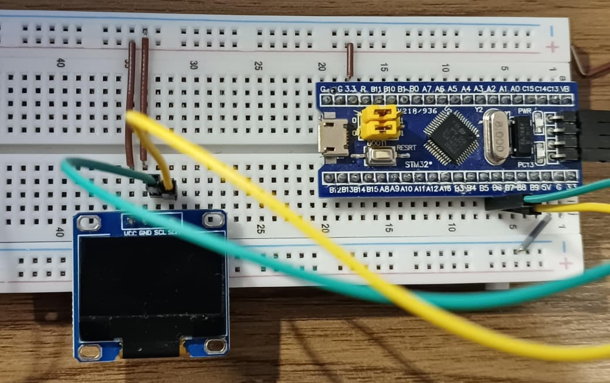
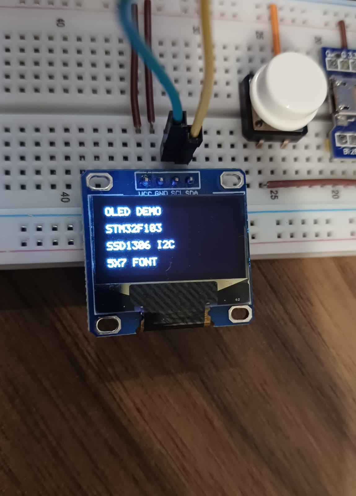
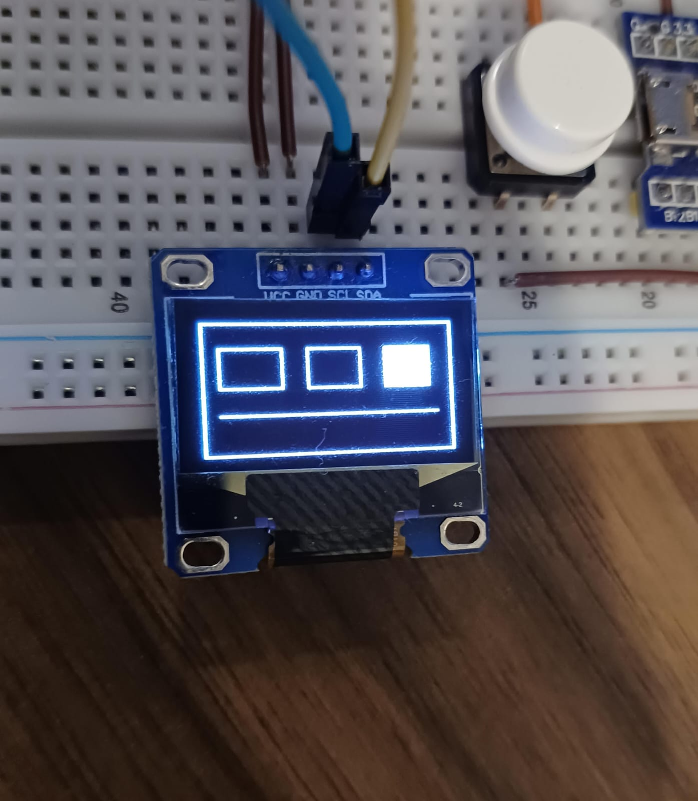

# STM32F103C8 SSD1306 OLED Driver

Bare-metal SSD1306 OLED driver for the STM32F103C8 Blue Pill using libopencm3, I2C and a Makefile-based build system.

---

## Features

- STM32F103C8 Blue Pill support
- SSD1306 128x64 OLED support over I2C
- Framebuffer-based rendering
- Pixel drawing
- Text rendering with 5x7 ASCII font
- Lines, rectangles and filled rectangles
- Rotating demo application
- Clean BSP / driver / app architecture
- No STM32CubeIDE or STM32CubeMX

---

## Hardware

- STM32F103C8 Blue Pill
- SSD1306 128x64 I2C OLED display
- ST-Link V2
- USB cable
- Jumper wires

---

## Wiring

| SSD1306 OLED | STM32F103C8 |
|---|---|
| VCC | 3.3V |
| GND | GND |
| SCL | PB6 |
| SDA | PB7 |

---

## Project Structure

```text
.
├── docs/
├── include/
│   ├── app/
│   ├── bsp/
│   └── drivers/
├── linker/
├── src/
│   ├── app/
│   ├── bsp/
│   └── drivers/
├── startup/
└── Makefile
```
---

## Build

This project expects `libopencm3` to be available next to the project directory:

```text

~/projects/
├── libopencm3/
└── stm32f103-ssd1306-oled/
```

### Build

```bash
make
```


### Generate binary:

```bash
make bin
```

### Flash

```bash
make flash
```

### Erase

```bash
make erase
```

### Erase + build + flash

```bash
make reflash
```

### Clean

It is a good practice to always clean before building the project.

```bash
make clean
```

---

## Basic Usage

Example inside `src/main.c`:

```bash
#include "drivers/ssd1306/ssd1306.h"

ssd1306_init();

ssd1306_clear();
ssd1306_draw_string(0U, 0U, "Hello", SSD1306_COLOR_WHITE);
ssd1306_draw_rectangle(0U, 16U, 64U, 24U, SSD1306_COLOR_WHITE);
ssd1306_update();
```

---

## Preview

### Hardware setup



### OLED demos






---

## Demo

The demo application rotates through:

- Text rendering
- Full printable ASCII charset
- Shape primitives
- Diagonal lines
- Checkerboard pattern
- All pixels on test

---

## Notes

The OLED display keeps its internal RAM while powered. Erasing or resetting the STM32 does not necessarily clear the OLED screen unless the firmware explicitly clears it, the OLED is power-cycled, or its hardware reset pin is controlled.

---

## License

MIT

## Author

Icaro Ramos Rodrigues dos Santos<br>
Embedded Systems | Firmware | Arm | STM32 | C | Verilog | UVM | Design Verification<br><br>

GitHub: https://github.com/IcaroRamosDM<br>
LinkedIn: https://www.linkedin.com/in/icaro-ramos-r/<br>
icaroelt@gmail.com<br>
