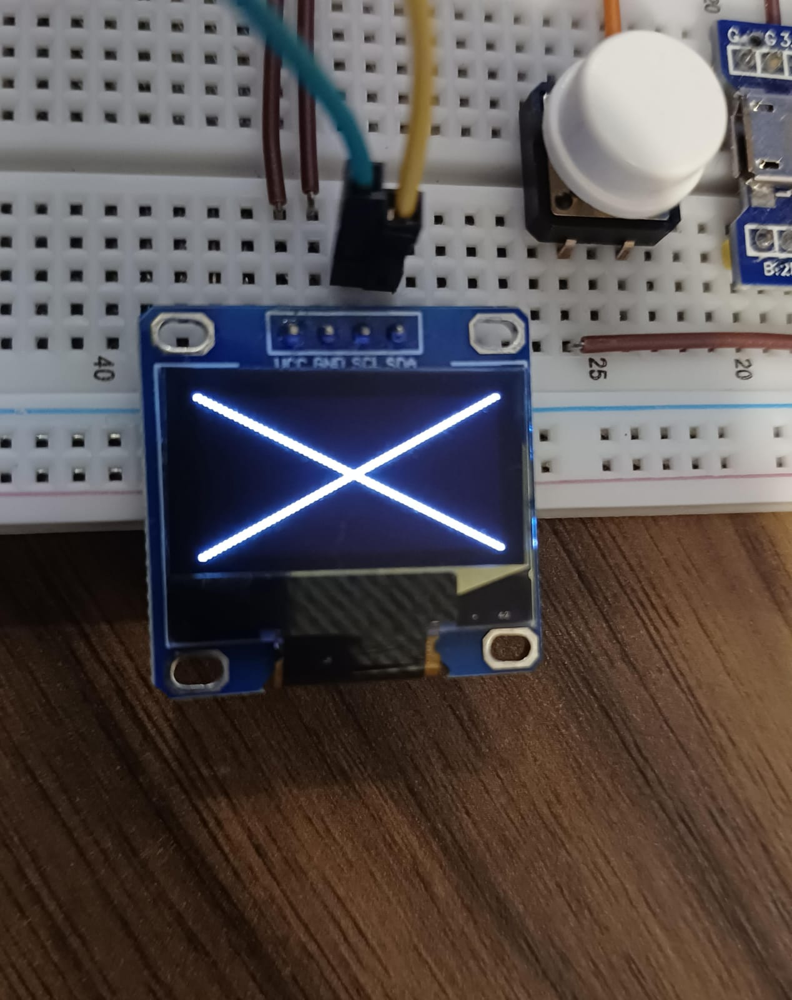

# STM32F103 SSD1306 OLED

Bare-metal SSD1306 128×64 display firmware using libopencm3 and I²C.
It includes a 1024-byte framebuffer, ASCII text, pixels, lines and rectangles.

## Rendering contract

Coordinates start at the upper-left corner: x = 0–127 and y = 0–63.
Shapes and glyphs are clipped at display edges. Off-screen coordinates do not
wrap back to the opposite edge. Strings stop at the right edge and NULL text is ignored.
Text draws only the glyph's active pixels; clear the background explicitly when needed.

## Build

[Build instructions](docs/build.md)

~~~sh
make all
make test
make sanitize
~~~

## Hardware and demonstration

[Wiring](docs/wiring.md): PB6 = SCL, PB7 = SDA, address 0x3C by default.
The demo rotates through text, printable characters, shapes, lines and pixel tests.

The photos document the existing setup. Resetting the MCU does not necessarily
clear the display's RAM; initialization explicitly clears and updates the framebuffer.

## License

[MIT](LICENSE).

## Author

**Icaro Ramos Rodrigues dos Santos** 
Electronic Engineer

Embedded Systems | Firmware | C | C++ | Python | Dart | Assembly | Hardware Design | PCB Design | STM32 | ARM Cortex-M | Linux | Windows | RISC-V | Verilog | SystemVerilog | UVM | Design Verification | Instrumentation | Signal Processing | Qt | FLTK

GitHub: [IcaroRamosDM](https://github.com/IcaroRamosDM) 
LinkedIn: [icaro-ramos-r](https://www.linkedin.com/in/icaro-ramos-r/) 
[icaroelt@gmail.com](mailto:icaroelt@gmail.com)
